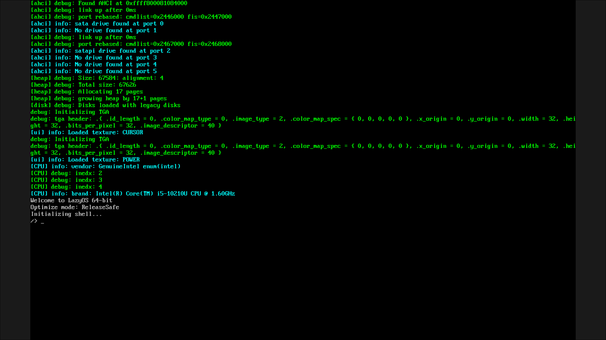

# LazyOS - an Operating System Kernel wrtiten in zig


<p align="center">
  
</p>

A small x86_64 operating system written in Zig.

LazyOS is a hobby operating system built from scratch to learn about
computer architecture, kernels, memory management, and low-level programming.

## Features

- x86_64 kernel
- Limine bootloader support
- Physical memory manager
- Virtual memory paging
- Kernel heap allocator
- Interrupt handling (IDT)
- GDT setup
- Task scheduler
- Multitasking support
- Custom kernel panic system
- Zig-based kernel development

## Screenshots


## Goals

The goal of LazyOS is to understand how modern operating systems work by
implementing core functionality from the ground up.

Some areas being explored:

- How CPUs execute code
- Memory management
- Hardware interaction
- Scheduling
- Kernel design
- Low-level software development

## Requirements

- Zig 0.16.0+
- QEMU
- Limine

**Note:** Additional dependencies may be required depending on your system.
If you find missing requirements, please open an issue or pull request.

## Building

```bash
git clone https://github.com/levi73159/LazyOS.git
cd LazyOS

zig build
```

## Running

Run LazyOS using QEMU:

```bash
zig build run
```

## Architecture

LazyOS currently only supports:

```yaml
Architecture: x86_64
Bootloader: Limine
Language: Zig
Environment: Virtual Machine (bare metal being tested)
```

## Current Progress

Implemented:

- Kernel booting
- Memory management
- Paging
- Heap allocator
- Interrupt handling
- Basic scheduler

Currently working on:

- Hardware drivers
- Running programs
- System calls

Planned:

- Multi threading
- Shared libary support
- Networking
- Userland shell

## Techincal Details

### Allocator Design

The Kernel Allocator uses a `LinkedList` based kernel heap allocator.
Physical memory is mapped using a `BitmapAllocator` and allocated pages
are mapped into the Higher Half Direct Map (HHDM)

The current allocator is simpler then the slab allocator but not as fast.
In the future I will upgrade it to the much faster slab allocator.

### Scheduling Design

The scheduler works by using a linked list and keeping track of the current, and the start task.
A task is a structure that has saved registers, allocated stack (unless it is the boot stack), a process attach for user land.
A next task, a task id, fs_base, and state.
The scheduler, if no task is ready to be run then the scheduler will fall back to an idle frame which will just sit and wait till and interrupt.

*Task states include:*

- ready (task is ready to run)
- running (task is the currently running task)
- dead (with exit code means the task is done running and needs to be clean up)
- waiting (wait for specific task to wake or exit)\
- wait_input (wait till the TTY input is ready for reading, usefull so we don't waste cpu time waiting for input)

## License

This project is licensed under the MIT License. See [LICENSE](LICENSE) for details.
